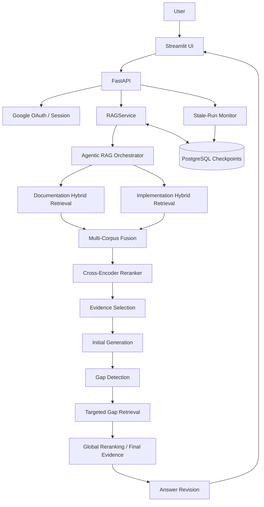
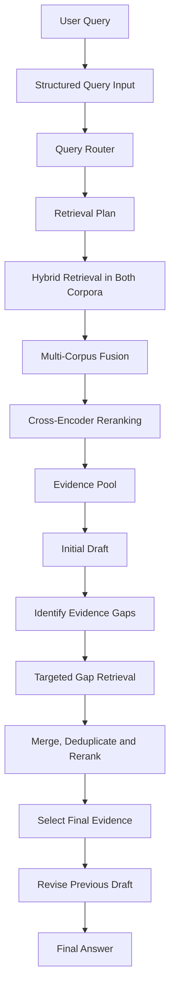

# Developer Docs Agentic RAG

A production-inspired **Agentic Retrieval-Augmented Generation (RAG)** application for investigating questions about LangGraph documentation and its Python implementation. It combines hybrid retrieval, cross-encoder reranking, iterative evidence gathering, answer revision, persistent checkpoints, and a FastAPI + Streamlit application.

**Repository:** https://github.com/Kunal719/Developer-Docs-AgenticRAG

> **Status note:** The repository has evolved beyond the original six-milestone Dense/Hybrid RAG README. Historical benchmark results from earlier pipelines are not presented as current Agentic RAG results unless they have been rerun against the current implementation.

## Contents

- [Capabilities](#capabilities)
- [Architecture](#architecture)
- [Agentic workflow](#agentic-workflow)
- [Retrieval and evidence](#retrieval-and-evidence)
- [Persistent runs and recovery](#persistent-runs-and-recovery)
- [Technology stack](#technology-stack)
- [Repository layout](#repository-layout)
- [Run with Docker Compose](#run-with-docker-compose)
- [Run locally](#run-locally)
- [Configuration and secrets](#configuration-and-secrets)
- [Evaluation and testing](#evaluation-and-testing)
- [Limitations and next steps](#limitations-and-next-steps)

## Capabilities

- Answers developer questions using two corpora: LangGraph documentation and selected LangGraph Python implementation source.
- Uses dense semantic retrieval and BM25 lexical retrieval, with Reciprocal Rank Fusion (RRF).
- Fuses candidates across corpora and reranks them with a cross-encoder.
- Selects evidence with provenance, deduplication, and gap-aware coverage.
- Can perform targeted retrieval for identified evidence gaps and revise the initial draft.
- Streams answers through FastAPI to a Streamlit UI.
- Supports Google OAuth, session handling, PostgreSQL-backed run/checkpoint persistence, stale-run monitoring, and resume support.
- Runs locally using Docker Compose with PostgreSQL, FastAPI, and Streamlit.

## Architecture

### System overview



### Agentic workflow



The workflow is bounded by a configured maximum of two generation rounds. The second generation is a **revision of the first answer**, rather than an independent answer. The final evidence set is kept distinct from the broader evidence pool; only the selected final evidence should be passed as generation context.

## Agentic workflow

1. **Route and plan.** Convert the question into structured input and a retrieval plan.
2. **Retrieve.** Search documentation and implementation corpora using dense and lexical retrieval.
3. **Fuse and rerank.** Combine rankings with RRF, fuse corpora, and use a cross-encoder to rerank candidates.
4. **Select evidence.** Normalize provenance, deduplicate overlapping evidence, and select an initial context.
5. **Draft.** Generate an initial answer grounded in the selected context.
6. **Find gaps.** Identify missing information and issue targeted retrieval requests when useful.
7. **Reassess evidence.** Merge candidates, deduplicate and rerank globally while preserving gap coverage.
8. **Revise.** Generate a revision using the prior draft and selected final evidence.
9. **Persist progress.** Save meaningful checkpoints and lifecycle state for status tracking and recovery.

## Retrieval and evidence

Each corpus has its own hybrid retrieval path:

```text
Dense semantic retrieval ─┐
                          ├─ RRF → ranked candidates
BM25 lexical retrieval ───┘
```

- **Dense retrieval:** helps find semantically related passages.
- **BM25:** helps match exact terms such as API names, classes, functions, and identifiers.
- **Reciprocal Rank Fusion:** merges result rankings without requiring the raw retriever scores to be comparable.
- **Multi-corpus fusion:** combines documentation and implementation candidates.
- **Cross-encoder reranking:** scores query–document pairs to improve candidate ordering.
- **Evidence selection:** keeps provenance, removes redundant passages, and aims to preserve coverage of identified gaps.

The current implementation uses separate Chroma vector stores and BM25 indexes for documentation and implementation. The reranker is `cross-encoder/ettin-reranker-32m-v1` with an ONNX inference path. Actual latency depends on the model runtime, hardware, candidate count, and query.

## Persistent runs and recovery

The system distinguishes two concepts:

- **RAG stage:** progress within the workflow.
- **Run status:** lifecycle state of the execution.

A `RAGCheckpoint` DTO stores restoration state such as schema version, query input, stage, generation round, retrieval plan, reranker query, evidence collections, generated answer, and gaps. Checkpoints are persisted in PostgreSQL. Evidence is stored in a checkpoint-specific representation and resolved back to documents during restoration rather than serializing complete framework document objects.

Run statuses include `RUNNING`, `COMPLETED`, `FAILED`, and `INTERRUPTED`. A heartbeat records worker liveness independently of meaningful checkpoint updates. A stale-run monitor can mark a run interrupted when its heartbeat becomes stale, and recoverable runs can be resumed from persisted state.

```text
Run starts
   ↓
Checkpoint persisted in PostgreSQL
   ↓
Worker/backend interruption
   ↓
Stale-run detection and interrupted status
   ↓
Restore checkpoint and resolve evidence
   ↓
Resume workflow
   ↓
Continue toward completion
```

Recovery starts from the last persisted checkpoint. It is not a guarantee that every in-flight external model call can continue from the exact instruction where it stopped.

## Application components

| Component | Responsibility |
|---|---|
| Streamlit | UI, session-aware interaction, streaming, run history/status and resume controls |
| FastAPI | Authentication routes, query streaming, run lifecycle and service orchestration |
| `RAGService` | Initializes and coordinates Agentic RAG execution and checkpoint persistence |
| PostgreSQL | Persistent checkpoint, run and user data |
| Chroma | Dense vector retrieval for each corpus |
| BM25 indexes | Lexical retrieval for each corpus |

The API includes `GET /health`. Run and authentication routes are defined in the API route modules; consult those files for exact request and response schemas.

## Technology stack

- Python 3.12
- LangChain ecosystem
- ChromaDB
- BM25 / `rank-bm25`
- Cross-encoder reranking with ONNX inference
- FastAPI and Uvicorn
- Streamlit
- PostgreSQL and `psycopg_pool`
- Google OAuth
- Docker Compose

## Repository layout

High-level map of the source tree; local indexes, data files, caches, and virtual environments are omitted.

```text
Developer-Docs-AgenticRAG/
├── app/
│   ├── api/                  # FastAPI routes and authentication
│   └── services/             # RAG service orchestration
├── checkpoint/               # Checkpoint persistence and run lifecycle
├── evidence/                 # Evidence representation and selection
├── ingestion/                # Parsing, chunking, metadata and ingestion
├── models/                   # Structured models and schemas
├── pipeline/                 # RAG pipeline setup and orchestration
├── prompt/                   # Prompt templates
├── reranking/                # Cross-encoder reranking
├── retrieval/                # Dense, BM25, hybrid and multi-corpus retrieval
├── router/                   # Query routing and retrieval planning
├── evaluation/               # Evaluation code and results
├── tests/                    # Automated tests
├── ui/
│   └── streamlit_app.py      # Streamlit frontend
├── utils/                    # Shared utilities
├── config.py
├── docker-compose.yml
├── Dockerfile.fastapi
├── Dockerfile.streamlit
├── requirements.txt
└── requirements.streamlit.txt
```

## Run with Docker Compose

Docker Compose is the recommended path for running the full local application.

### Prerequisites

- Docker Desktop with Docker Compose.
- An LLM provider key configured for the application.
- Google OAuth credentials and a matching callback URL if using Google sign-in.

### 1. Clone

```powershell
git clone https://github.com/Kunal719/Developer-Docs-AgenticRAG.git
cd Developer-Docs-AgenticRAG
```

### 2. Configure environment variables

Create a local `.env` file. Use the exact variable names required by `config.py`, `app/api/auth_routes.py`, and the service code. The deployment needs correctly configured values for:

- LLM credentials and model settings.
- `POSTGRES_PASSWORD`.
- `DATABASE_URL`.
- `SESSION_SECRET_KEY`.
- Google OAuth client ID, client secret, and redirect URI.

When FastAPI runs inside Docker Compose, `DATABASE_URL` must use `postgres` as the database hostname, not `localhost`. Use a strong, unique session secret. Never commit `.env` or publish credentials.

### 3. Start the stack

```powershell
docker compose up -d --build
docker compose ps
```

### 4. View logs

```powershell
docker compose logs --tail=100 -f fastapi
```

In another terminal:

```powershell
docker compose logs --tail=100 -f streamlit
```

Press `Ctrl+C` to stop following logs; it does not stop the containers.

### 5. Open the application

- Streamlit: http://localhost:8501
- FastAPI health check: http://localhost:8000/health

### Persistence warning

PostgreSQL uses the named volume `postgres_data`. Stopping or recreating containers normally preserves the volume.

**Do not run `docker compose down -v` unless you intentionally want to delete the named volumes and stored database data.**

### Rebuild only Streamlit

For frontend-only changes:

```powershell
docker compose build streamlit
docker compose up -d --no-deps --force-recreate streamlit
```

`--no-deps` avoids recreating FastAPI and PostgreSQL as Streamlit dependencies. Rebuild the backend only when a backend or backend-image dependency change requires it.

## Run locally

For development outside Docker, use Python 3.12 and configure environment variables first. You also need a PostgreSQL instance and access to the required model provider.

Create and activate a virtual environment on Windows:

```powershell
python -m venv .venv
.\.venv\Scripts\Activate.ps1
```

Install dependencies:

```powershell
python -m pip install -r requirements.txt
python -m pip install -r requirements.streamlit.txt
```

Start FastAPI:

```powershell
uvicorn app.api.main:app --host 0.0.0.0 --port 8000
```

Start Streamlit in a second terminal:

```powershell
streamlit run ui/streamlit_app.py --server.port 8501
```

Set `DATABASE_URL` to a hostname reachable from the host machine. `localhost` is commonly used for a database running directly on the host; `postgres` is used from containers on the Compose network. Ensure the OAuth callback and frontend API/login URLs match the addresses used in the browser. Mixing `localhost` and `127.0.0.1` can cause session cookies to behave differently.

## Configuration and secrets

Keep configuration outside source code. Check the current config and route files for the exact variable names and defaults. Configuration categories include:

| Category | Purpose |
|---|---|
| LLM credentials/model settings | Embeddings and answer generation |
| Source repository paths | Documentation and implementation ingestion |
| Chroma and BM25 paths | Persistent retrieval indexes |
| `DATABASE_URL` | PostgreSQL connection |
| `POSTGRES_PASSWORD` | PostgreSQL container initialization |
| `SESSION_SECRET_KEY` | Signing the FastAPI session cookie |
| Google OAuth credentials | Sign-in |
| Redirect and frontend URLs | Browser-to-API authentication flow |

If a credential is committed accidentally, rotate it; deleting it from the latest file does not invalidate it.

## Evaluation and testing

The project evolved through Dense RAG, incremental indexing, hybrid retrieval, cross-encoder reranking, multi-corpus retrieval, and Agentic RAG. The earlier evaluation framework included Recall@K, Precision@K, Hit Rate@K, MRR, LLM-as-judge assessments, latency, and token/cost measurements.

An earlier 82-question benchmark measured a previous pipeline. **Those results are not claimed as current Agentic RAG results.** For an honest comparison, run the current benchmark and record its dataset, model, retrieval limits, hardware/runtime, latency, and scores together.

Run tests from the repository root:

```powershell
pytest
```

For a focused test:

```powershell
pytest tests/<test_file>.py -q
```

Replace the placeholder with a real test filename from the checkout. Tests requiring credentials, indexes, or external model calls may need additional prerequisites.

## Limitations and next steps

- Answer quality depends on corpus coverage, retrieval ranking, evidence selection, and model behavior.
- Reranker latency and resource use depend on hardware and candidate volume.
- Recovery starts from persisted checkpoints; exact continuation of every in-flight external operation is not guaranteed.
- Source metadata delivery should be verified end-to-end against the current streaming API contract.
- Current Agentic RAG performance figures should be reported only after running the benchmark against the current code.
- Docker Compose is a local development/demo deployment, not a hardened production deployment.

## Design principles

- Add complexity only when there is a clear retrieval or reliability need.
- Keep ingestion, retrieval, reranking, evidence selection, generation, and persistence modular.
- Preserve evidence provenance and make the final generation context explicit.
- Separate workflow stage from run lifecycle status.
- Keep worker heartbeats distinct from meaningful checkpoint updates.
- Treat evaluation and failure analysis as part of engineering.
- Prefer reproducible setup and documented trade-offs over unverified claims of production readiness.
